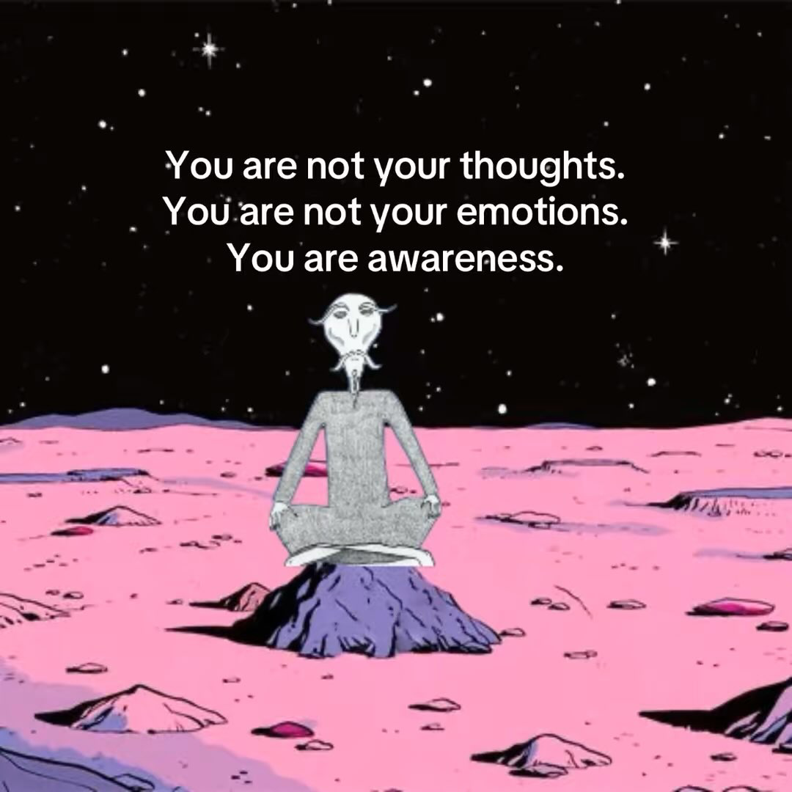

Recientemente he comprado un libro llamado: *Stop Abusing Your Self-Awareness: When Awareness Becomes a Cage: From Obserter to Participant*. He estado leyendo el primer capítulo y esto es lo he aprendido:

 

# los pensamientos son el 90% del problema
---

> Decirle a una persona que sobrepiensa que "simplemente pare de sobrepensar" es como decirle a una persona adicta que "simplemente pare de serlo". – Kinzer

En este capítulo el autor habla sobre los pensamientos que tenemos en nuestra mente a diario y que, para las personas que sobrepiensan demasiado, estos son el 90% del problema.

Y es que la mayoría de personas piensan que los pensamientos no son importantes, que no afectan en nuestra vida. Esto no es verdad. Ignorar este hecho hace que nunca seamos realmente libres de "sobrepensar".

Según el autor, existen dos tipos de pensamientos:

- **Pensamientos aleatorios**. Estos son los que surgen espontáneamente y que no te ayudan en nada. Tienes que ignorarlos.
- **Pensamientos controlados**. Estos son los que "creamos". Son los que realmente te ayudarán.

Teniendo en cuenta esto, es importante saber que si **tenemos que pensar en algo, siempre tenemos que hacerlo de la manera más optimista y esperar siempre lo mejor.**

Si nos encontramos fantaseando o creando escenarios imaginarios, tenemos que hacerlo asumiendo que todo está a nuestro favor y trata el pensamiento como si fuera una práctica de afirmación. La mejor manera de cambiar nuestro diálogo interior es a través de acciones que afirmen que somos esa "nueva persona".

Nunca dejes que tus pensamientos te convenzcan de que no te mereces ser feliz. Te lo mereces. Tampoco dejes que tus pensamientos te hagan sentir miserable o con un sentimiento de culpa. **Deja de confiar en tus pensamientos**.

Los pensamientos en los que has estado confiando hasta ahora no te ha dado nada. Solo te han dado cosas negativas: miedo, ansiedad, culpa...

 

## conclusión
---

Creo que aplicar todo el conocimiento de este libro puede mejorar bastante tu vida, sobretodo para esas personas que sobrepiensan demasiado. Si sufres de esta "enfermedad", realmente recomiendo leerlo. Por ahora, estoy aprendiendo bastante.

> You are not your thoughts.

Seguiré con la lectura. Hasta la próxima publicación.